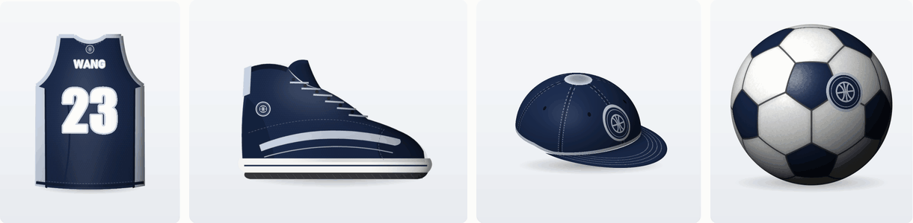

# 運動用品客製購物系統

C++17 和 wxWidgets 寫的 Windows 購物程式，可以在球衣、帽子、球上印自己的名字和背號。

## 怎麼跑

[下載 Windows 版](../../releases/latest)，解壓縮後執行。

自己編：需要 Visual Studio（C++ 桌面開發）和 wxWidgets 3.3。設定 `WXWIN` 環境變數指到 wxWidgets，打開 `CustomSportswearStore.sln`，選 x64 按 F5。
